# WorldBlaze

A Spigot 1.8.x plugin that brings online-casino style minigames to a Minecraft server, all played through chest GUIs: **Graph, Crash, Double, Mine, Animal Game and CoinFlip**.

## About this project

WorldBlaze was built around **mid-2022** for a Brazilian Portuguese Minecraft server I used to run. Back then everything (config keys, messages, menus, commands, class names, even the animals) was in Portuguese.

Recently I came back to it and only did housekeeping:

- translated everything to English (config keys, messages, menus, commands, code identifiers and comments);
- reorganized the folder structure and moved the build to Gradle;
- added a pluggable cash provider (GrandeCash, PlayerPoints or yPoints) instead of a hard dependency;
- fixed a handful of bugs I found along the way.

The games themselves are **the same as they were in 2022**: no big rewrites and no logic changes. If you want to see exactly what changed, the first commit is the project as it was and every commit after it is a small, focused step.

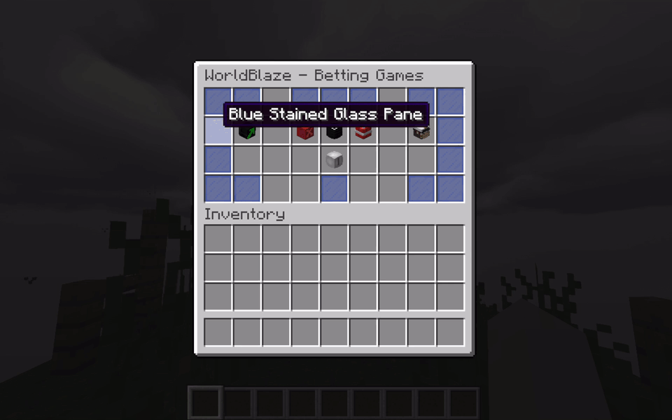

> Hover over each game in `/blaze` to see its name, accepted bets, return, game type and release date. Right-click a game for a tutorial, left-click to play.

### Games at a glance

| Game | Type | Bets | Return |
|------|------|------|--------|
| [Graph](#graph) | Public | Money and cash | Bet + 82% if you guess the direction |
| [Crash](#crash) | Public | Money and cash | Multiplier at the moment you cash out |
| [Double](#double) | Public | Money and cash | 2x on red/black, 14x on white |
| [Mine](#mine) | Single player | Money and cash | Grows with every safe slot |
| [Animal Game](#animal-game) | Public | Money and cash | 2x on the drawn animal |
| [CoinFlip](#coinflip) | Duo | Money and cash | The pot, minus the house cut |

Every game accepts **money** (through Vault) and **cash** (a second currency from a supported plugin), and both can be combined in the same bet.

---

## Graph

A live line chart drawn inside the inventory. A new point is added every few seconds and the line goes up or down. You bet on whether the chart will end **higher or lower** than it is right now, a few updates from now.

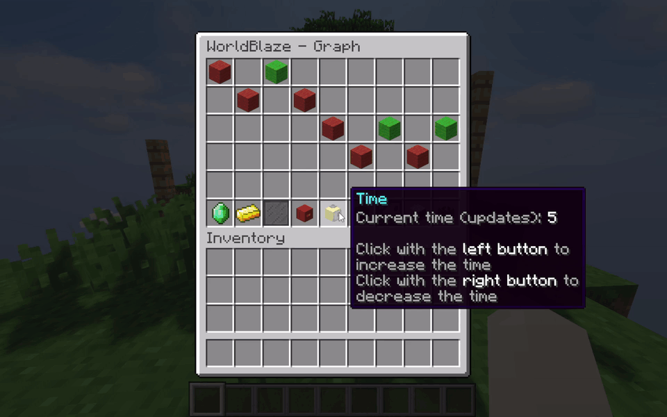

- Pick how many updates ahead you are betting on (right-click / left-click on the clock).
- Type your money and cash amounts in the chat.
- Click the **up** or **down** arrow to bet. If the chart ends where you said, you get your bet back plus the configured return.

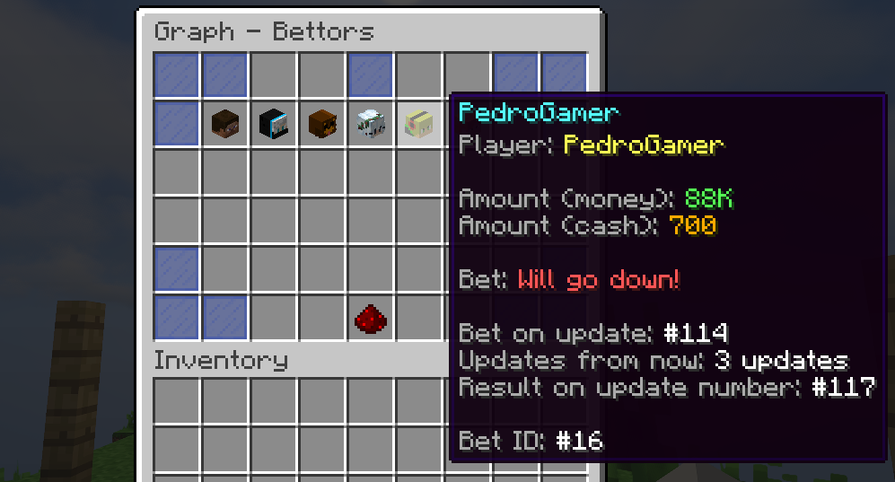

### Behind the scenes

The chart is not pure noise. Each new point is a yes/no decision (up or down) that moves the value by a random amount between `min-random` and `max-random`. How that decision is made depends on where the chart is inside a **cycle of 33 points**, and on how many players bet on each side. Only the **number of bets** counts, not how much was bet.

- **Start of the cycle:** the trend for the next cycle is picked **against the side with more bets**. If most players bet up, the trend is down, and the other way around. With a tie it is a coin flip. The first point of the new cycle moves the other way, which makes the chart look like it is about to follow the crowd.
- **Most of the cycle (points 1 to 24):** each point is a coin flip, with two small tweaks: a 15% chance of moving against the majority of the bets and a 10% chance of moving with it. Against the crowd is slightly more likely than with it.
- **Points 25 to 27:** the chart is pushed gently against the trend (45%, 40% and 35% chance of following it).
- **Points 28 to 32:** it recovers and gets pushed hard along the trend (60%, 70% and 80%), and the last two points always follow it.

Since bets are resolved 3 to 8 points after they are placed, the trend ends up deciding many of the results. Turn on `config.debug` to watch the next trend and the special phases in the console.

---

## Crash

A multiplier starts at 1.00x and keeps climbing. Cash out before it crashes and you keep the multiplier; wait too long and you lose the bet.

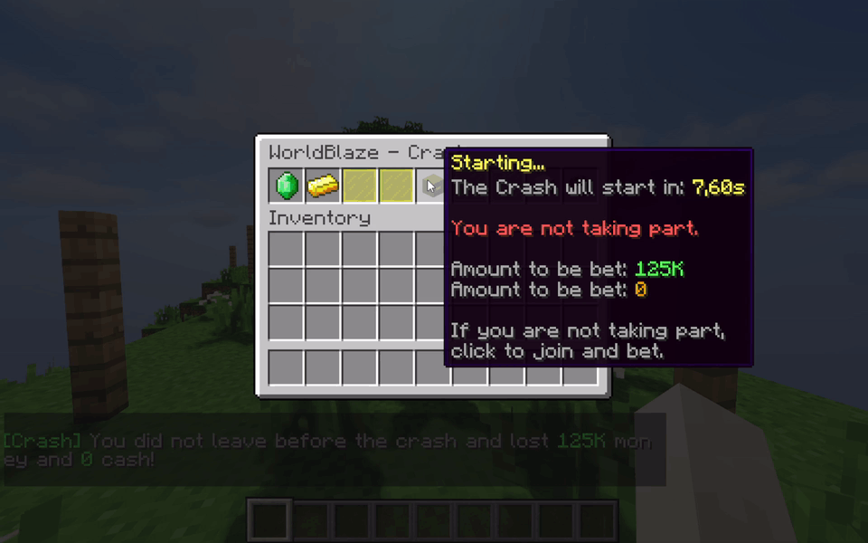

- The round has a starting screen where players decide whether to join.
- The glass panes in the menu change color with the round state (starting, running, crashed).
- Every cash out above the configured value is announced to the server.

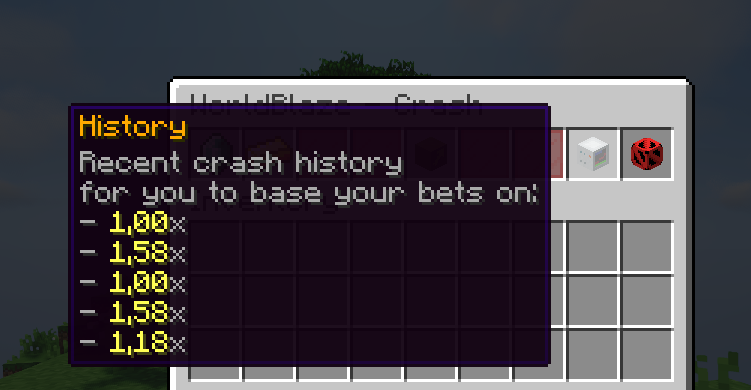

### Behind the scenes

The crash point is rolled **before** the round starts, from a weighted list in `config.yml` (`config.crash.values`, formatted as `from;to;chance`). It does not look at who is betting, and there is no rigging in this game.

To roll it, the list is shuffled and the first entry gets a chance to be accepted (its `chance`); if it fails, the list is shuffled again, until one is accepted. The crash point is then a random value between `from` and `to` of that entry. In practice an entry with a higher chance is picked more often, and the odds of the entries are relative to each other, not absolute percentages. An entry with `from` equal to `to` crashes at exactly that value, so `1.00;1.00` is an instant crash.

The multiplier climbs by `crash-tick-sum-initial` per tick (0.01, so about 0.2x per second) during the first `crash-start-time` seconds, then by `crash-tick-sum-final` (0.05, about 1x per second), which is why the number speeds up as the round goes on. With the default values every round crashes before 2.13x, so raise the ranges if you want bigger multipliers.

---

## Double

A roulette of colors. A strip of red, black and white slots spins, slows down and stops on the winning color. Bet on the color you think will land.

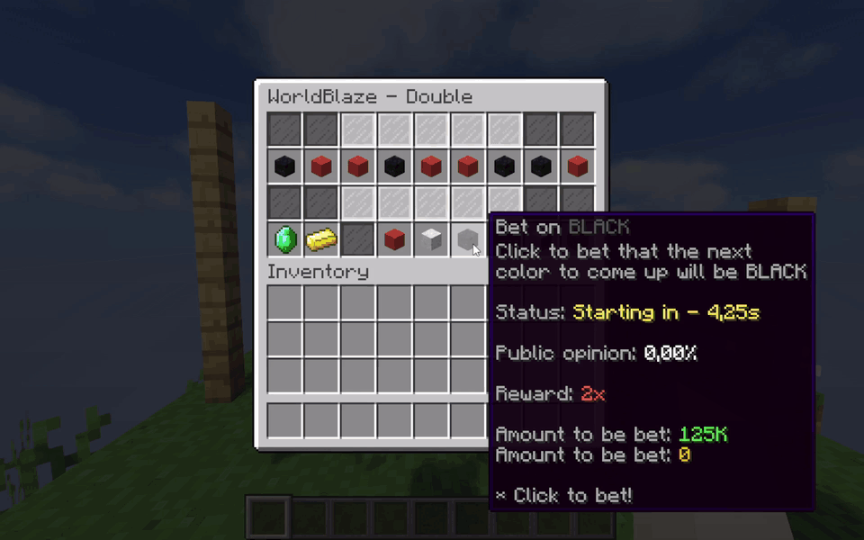

- **Red** and **black** pay 2x.
- **White** is rare (1% by default) and pays 14x.
- The animation speed, duration and the odds are all configurable.

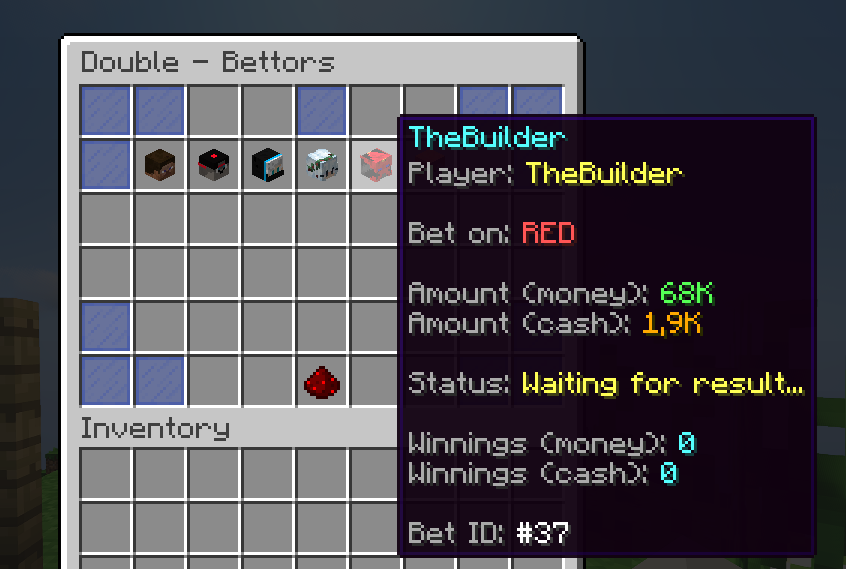

### Behind the scenes

The winning color is decided **before** the roulette starts spinning, when the starting countdown ends. The animation only reveals a result that already exists: the colors that scroll by are random and the real one is placed in the strip at a fixed moment, so it lands exactly on the center slot.

**Normal rounds.** The color is rolled with the current chances of red, black and white, which start at `initial-red-chance`, `initial-black-chance` and `initial-white-chance` (49.5 / 49.5 / 1.0). They change after every round to avoid long streaks:
- When red or black wins, that color loses 10% of its starting chance (about 4.95 points), and the points go to the other two colors (7/8 to the other main color and 1/8 to white).
- When white wins, all the chances go back to the starting values.

So the longer a color keeps winning, the less likely it gets to repeat, and white slowly becomes more likely the longer it stays away.

**Rigged rounds.** If `config.double.rigging` is enabled and the round's total bet reaches the configured money or cash value, there is a chance (60% by default) that the round is rigged. The house then looks at how much was bet on each color (in cash if anyone bet cash, otherwise in money) and makes the color with the **second most** bet win, with a 1% chance of white instead. In practice this makes the side that bet the most lose. It can be disabled with `rigging.enabled: false`.

---

## Mine

A single-player minesweeper-like board that takes the whole inventory. Each slot hides either a safe tile or a mine. Every safe tile raises your multiplier, and you can cash out at any time after the first click.

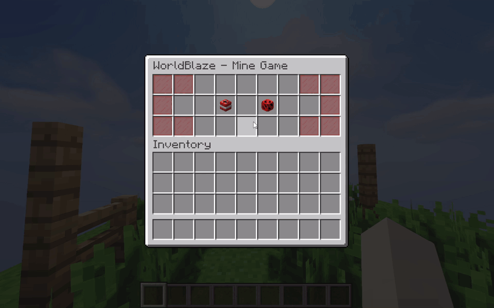

- Choose how many mines the board has (3 up to 52 by default). More mines means a higher maximum multiplier.
- Hit a mine and the bet is lost.
- Other players can watch ongoing matches from the players menu.

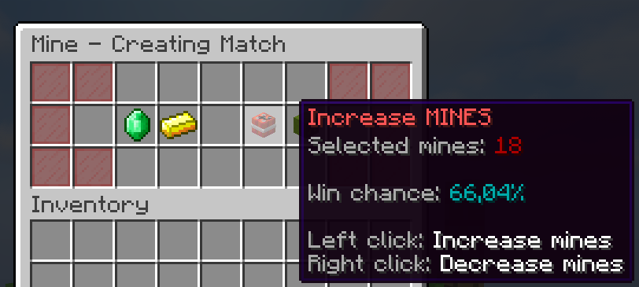
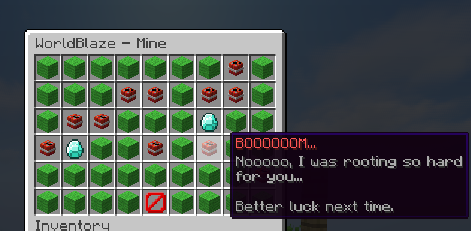

### Behind the scenes

Mines are not all placed the same way. When the match starts, all the mines **except one** get a fixed position on the board. The last one has no position: every time you click a tile that is not one of the fixed mines, the game rolls the chance of that tile being the last mine, which is `1 / remaining tiles`. So the fewer tiles are left, the riskier each click gets, and the last tile is always a mine.

The house can rig big bets by making that roll harsher. When a match starts, the bet is checked against the thresholds in `config.mine.rigging` (separate lists for money and cash, each with its own chance, and the highest threshold reached wins). The higher the bet, the higher the chance that the match is "caught". If it is, the chance of that roll is multiplied (10x by default, `chance-multiplier`) on every click. The fixed mines are never moved. Small bets are never affected, and it can be disabled with `rigging.enabled: false`.

---

## Animal Game

The plugin's version of the **Jogo do Bicho**, a very Brazilian lottery where each bet is placed on an animal. It is not a casino staple outside of Brazil, so it is the one game here that has no direct online-casino counterpart.

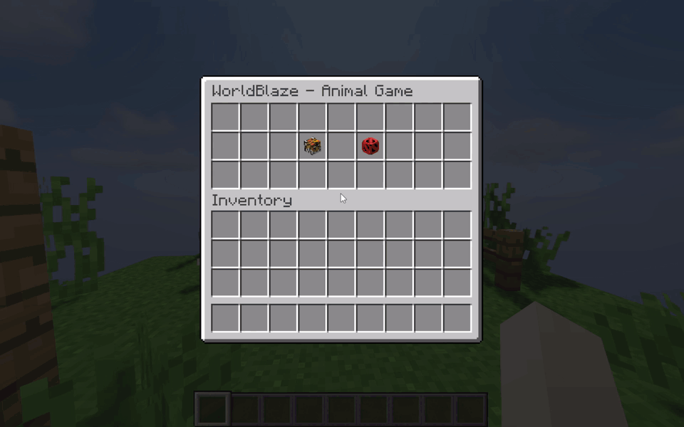

- 25 animals, each shown with its own head in the menu.
- Bets stay open until staff run `/animalgame draw`, which picks the animal and pays 2x to everyone who bet on it.
- Staff can force a result with `/animalgame draw <animal>`.
- Open bets are saved to `data.yml`, so they survive restarts.

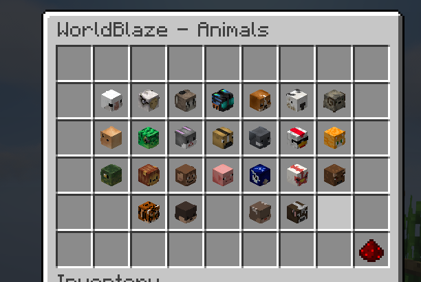

### Behind the scenes

The house can rig the draw. When a bet goes over a threshold of money or cash (`config.animal-game.rigging`), there is a configurable chance (60% by default) that the animal it was placed on is removed from the draw, so big bets are less likely to win. It can be disabled with `rigging.enabled: false`.

---

## CoinFlip

A head-to-head duel. One player creates a game picking heads or tails and the amount to bet; another player joins the opposite side and the coin is flipped.

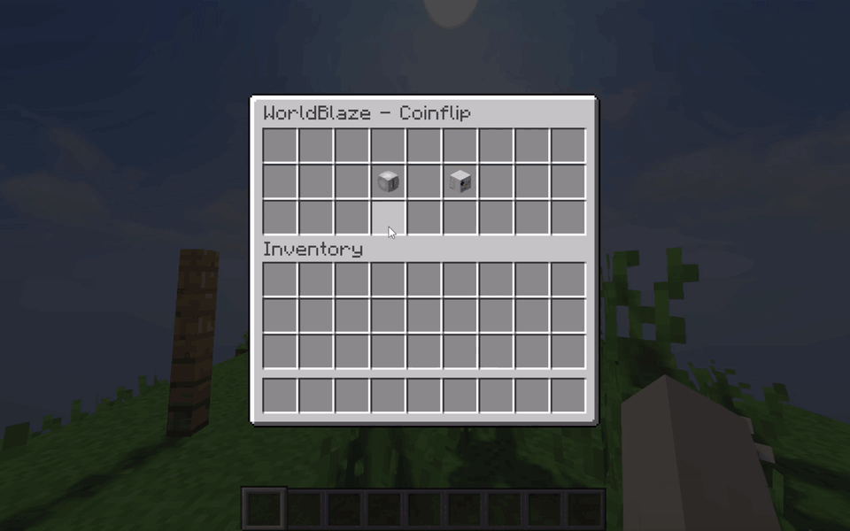

- The coin in the middle of the menu keeps swapping sides while it flips (`swap-interval`, `flipping-time`) and then lands on the result.
- The winner takes the pot minus the house cut (`payout-rate`, 90% by default).
- Spectators can open any ongoing game with `/viewcoinflip`.

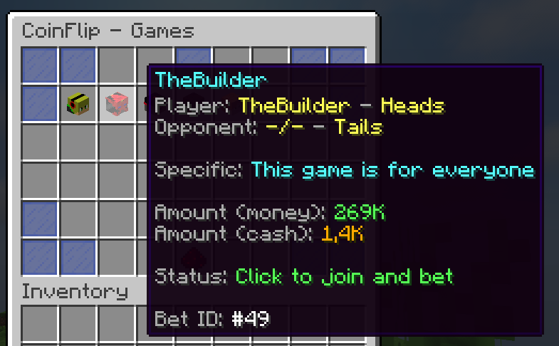

### Behind the scenes

This is the only game without any house influence: the result is a plain 50/50 coin, rolled when the flip ends. The coin swapping on the menu while it spins is just the animation and has no effect on the result. Since it is player versus player, the house only earns from the cut: with `payout-rate: 90.0`, the winner receives 90% of the total pot and the other 10% is removed from the economy.

---

## Requirements

- Spigot (or a fork) **1.8.x**
- Java 8+
- [Vault](https://www.spigotmc.org/resources/vault.34315/) plus an economy plugin, for the money bets
- Optional, for cash bets: **GrandeCash**, **PlayerPoints** or **yPoints**

Cash is detected automatically (`config.cash-provider: auto`), in the order GrandeCash, PlayerPoints, yPoints. You can force one in `config.yml`, or set `none` to disable cash bets.

## Installation

1. Drop `WorldBlaze.jar` in your `plugins` folder.
2. Start the server once so the configuration files are generated.
3. Tweak `config.yml` and the menus in each game's folder, then run `/blaze reload`.

## Commands

| Command | Description |
|---------|-------------|
| `/blaze` (aliases: `/worldblaze`, `/bets`, `/games`) | Opens the main menu |
| `/blaze help` | Lists the commands |
| `/graph`, `/crash`, `/double`, `/mine`, `/animalgame`, `/coinflip` | Opens a game directly |
| `/viewcoinflip` | Opens the list of ongoing CoinFlip games to watch |
| `/blaze lock` / `/blaze unlock` | Admin: blocks or allows new games |
| `/blaze reload` | Admin: reloads every file once the games in progress are over |
| `/animalgame draw [animal]` | Admin: draws the Animal Game |

### Permissions

| Permission | Grants |
|------------|--------|
| `worldblaze.admin` | `/blaze lock`, `/blaze unlock`, `/blaze reload`, `/animalgame draw [animal]`, and shows these commands in the help lists |
| `worldblaze.graph` | `/graph` and the Graph button in the `/blaze` menu |
| `worldblaze.crash` | `/crash` and the Crash button in the `/blaze` menu |
| `worldblaze.double` | `/double` and the Double button in the `/blaze` menu |
| `worldblaze.mine` | `/mine` and the Mine button in the `/blaze` menu |
| `worldblaze.animalgame` | `/animalgame` and the Animal Game button in the `/blaze` menu |
| `worldblaze.coinflip` | `/coinflip`, `/viewcoinflip` and the CoinFlip button in the `/blaze` menu |

`/blaze` and `/blaze help` need no permission. Players can open the main menu without any of the game permissions, but each game button only works with its own.

## Configuration

Everything lives in `config.yml` (limits, odds, alerts, messages) and in one yml per menu, where you can change titles, rows, items, slots, heads and lores. Messages use `&` color codes and support the placeholders described in the file's comments.

## Building

```bash
./gradlew build    # creates build/libs/WorldBlaze.jar
./gradlew deploy   # builds and copies the jar to your plugins folder (-PpluginsDir=<path> to change it)
```

The project compiles against the jars in `libs/` for the cash providers that have no public repository. The repository ships a stub for GrandeCash only to make it compile; the real plugin is what runs on the server.
